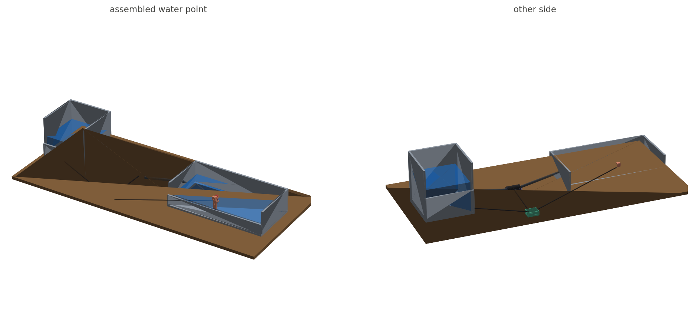
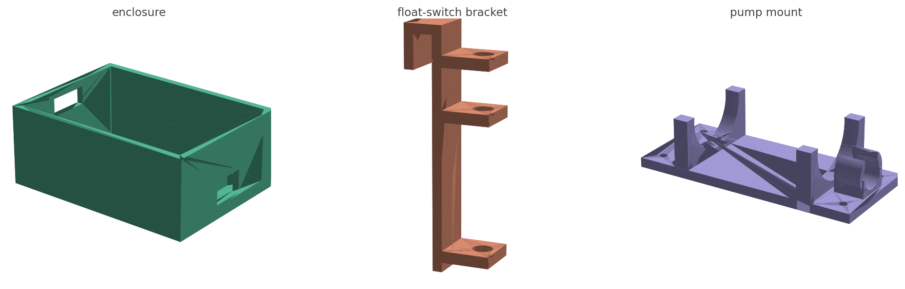
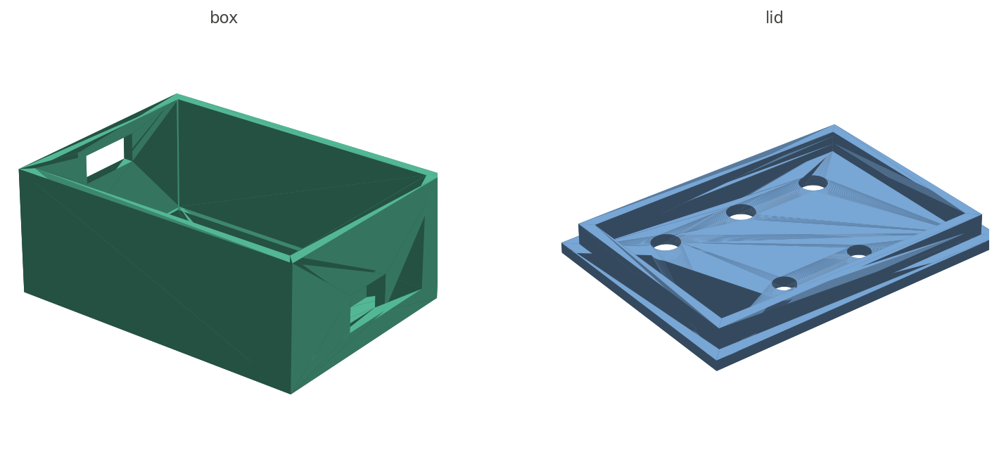
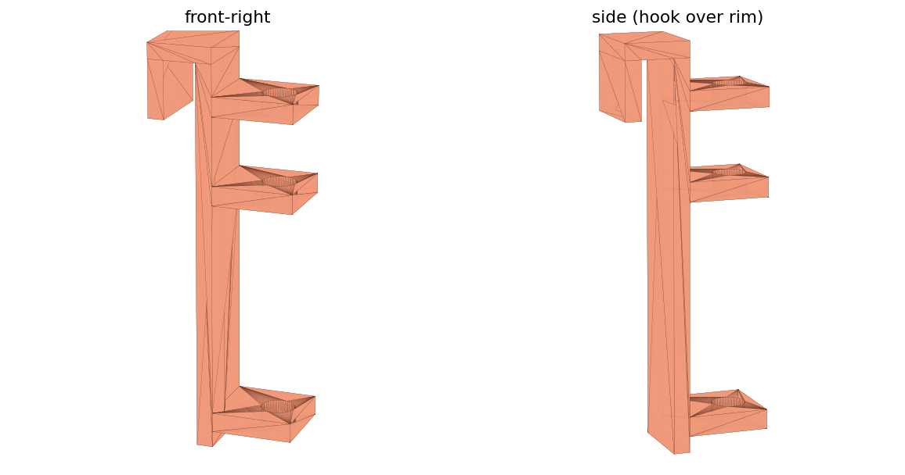
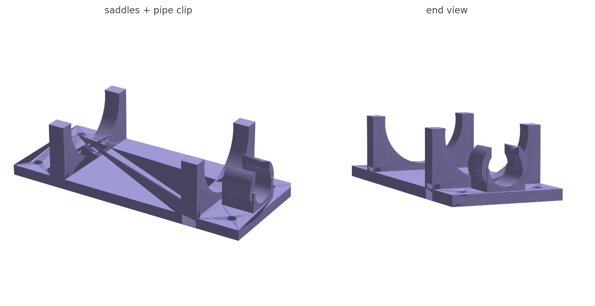

# DDROID livestock water-point simulation

Prototype for the NUST group project **DDROID Smart Livestock Watering and Monitoring System**.

Author: n02528843x@students.nust.ac.zw

The machine is a stationary water-point controller. An ESP32-style state machine reads float switches, runs a low-voltage pump, and latches faults. Gazebo shows the bench. ROS 2 carries the same status and operator commands.

This copy was installed and run on:

| Item | Version used here |
| --- | --- |
| Host | Windows, WSL2 |
| Guest | Ubuntu 26.04.1 LTS (Resolute), x86_64 |
| Gazebo | Jetty, `gz sim` 10.5.0 (`gz-jetty` from the OSRF stable archive) |
| ROS 2 | Lyrical, `ros-lyrical-ros-base` |
| Python | 3.14 |

Ubuntu 26.04 is the platform ROS 2 Lyrical publishes packages for. Gazebo Jetty is the matching simulator (`gz-sim` 10) in the OSRF archive for the same Ubuntu release. Older pairs such as ROS 2 Jazzy plus Gazebo Harmonic target Ubuntu 24.04, so they were not installed on this PC.

On this machine the Gazebo window needs software OpenGL. WSLg plus the hardware OpenGL path crashed the Ogre renderer. `simulation/launch_gui.sh` sets `llvmpipe` for that reason.

## 1. Install Gazebo

Inside Ubuntu, as root:

```bash
apt-get update
apt-get install -y curl ca-certificates gnupg
curl -fsSL https://packages.osrfoundation.org/gazebo.gpg \
  -o /usr/share/keyrings/pkgs-osrf-archive-keyring.gpg
echo "deb [arch=$(dpkg --print-architecture) signed-by=/usr/share/keyrings/pkgs-osrf-archive-keyring.gpg] https://packages.osrfoundation.org/gazebo/ubuntu-stable $(. /etc/os-release && echo $UBUNTU_CODENAME) main" \
  > /etc/apt/sources.list.d/gazebo-stable.list
apt-get update
apt-get install -y gz-jetty python3-gz-transport15 python3-gz-msgs12
gz sim --versions
```

`gz sim --versions` should print `10.5.0` or another Jetty `gz-sim` 10 release. This PC already has that install, so the command is only needed on a new machine. `simulation/install_gazebo.sh` repeats the package install when the OSRF source is already configured.

## 2. Install ROS 2 Lyrical

As root, from the repository root:

```bash
bash simulation/install_ros2.sh
```

That script adds `http://packages.ros.org/ros2/ubuntu resolute` and installs `ros-lyrical-ros-base`, `ros-lyrical-std-msgs`, colcon, and rosdep.

Check it:

```bash
source /opt/ros/lyrical/setup.bash
ros2 pkg list | head
```

## 3. Controller check without Gazebo

From `simulation/` in Ubuntu:

```bash
cd simulation
python3 test_control.py
```

The script must finish without an assertion. It arms a refill, rejects a reset while the supply is still low, then clears a high-cutoff fault only after the cutoff switch has dried.

## 4. Run the Gazebo scene

From Ubuntu, with WSLg (`DISPLAY=:0`):

```bash
bash simulation/launch_gui.sh
```

A window titled **Gazebo Sim** opens. The bench is in the middle of the ground plane. Scroll to zoom and drag to orbit. Leave this terminal running.

## 5. Run the ROS 2 demonstration

In a second Ubuntu terminal, from the repository root:

```bash
bash run_ros_demo.sh --gazebo
```

The first run builds `ros2_ws`. The node then publishes while the story runs:

1. Startup is STOPPED and the pump is OFF.
2. Arming a low trough starts REFILLING until FULL, then IDLE.
3. Drinking through ADEQUATE does not start the pump again. The next LOW does.
4. That refill crosses the supply-low switch and latches LOW SUPPLY. Reset is rejected until the supply is topped up.
5. After reset and arm, a second refill completes.
6. A safety drill holds the pump on until the independent high cutoff removes pump drive.
7. After the cutoff dries, reset returns STOPPED and arm leaves the machine IDLE.

Watch the middleware from a third terminal:

```bash
source /opt/ros/lyrical/setup.bash
source ros2_ws/install/setup.bash
ros2 topic echo /ddroid/status
```

Other topics: `/ddroid/mode`, `/ddroid/pump`, `/ddroid/fault`, `/ddroid/trough_state`, `/ddroid/supply_state`, `/ddroid/trough_litres`, `/ddroid/supply_litres`.

Without a window, omit `--gazebo`:

```bash
bash run_ros_demo.sh
```

`bash verify_ros.sh` rebuilds the package, reruns the controller checks, and prints one `/ddroid/status` message.

## 6. Operator commands

Stop the demo and start the command node instead. Gazebo can already be running.

```bash
source /opt/ros/lyrical/setup.bash
source ros2_ws/install/setup.bash
export GZ_PARTITION=ddroid
export DDROID_SIM="$PWD/simulation"
ros2 run ddroid_water_point ddroid_controller --gazebo
```

From another terminal:

```bash
ros2 topic pub --once /ddroid/command std_msgs/msg/String "{data: arm}"
```

Accepted commands are `arm`, `stop`, `reset`, `acknowledge`, `manual`, and `topup`.

## What the code does

- `simulation/ddroid_control.py` is the plant and the STOPPED / IDLE / REFILLING / MANUAL / FAULT state machine from the SRS. Float changes need two one-second samples. The high cutoff acts on the same step and drops pump drive even if software still asks for it.
- `simulation/ddroid_demo.py` is the supervised story above.
- `simulation/build_world.py` writes `simulation/worlds/ddroid_water_point.sdf`.
- `simulation/run_sim.py` moves the water slices, switch markers, and lamps in Gazebo.
- `ros2_ws/src/ddroid_water_point` is the ROS 2 package that publishes that state and accepts commands.

Regenerate the world after a geometry change:

```bash
cd simulation
python3 build_world.py
```

## 3D-printed hardware

Printable mounting parts for the physical water point live in
[`hardware/`](hardware/) — each with an STL, a parametric generator and a print
guide. See [`hardware/README.md`](hardware/README.md) for the full assembly.

### Assembled system

The whole water point — supply tank, pump, pipe, trough, float-switch bracket
and controller — as one model. Open
[`hardware/system-assembly/system_assembly.stl`](hardware/system-assembly/system_assembly.stl)
on GitHub to rotate it in the browser.



### Printed parts



### ESP32 controller enclosure

Box + lid sized for the ESP32 DevKit, with USB/cable slots, board standoffs and
lid holes for the LOW/FULL/STOP buttons and PUMP/IDLE LEDs.



### Float-switch bracket

Clips over the trough rim and holds the float switches at the LOW (48 mm),
FULL (120 mm) and cutoff (147 mm) heights — the 30 / 75 / 92% thresholds.



### Pump / pipe mount

Saddle cradles that clamp the pump body (zip-tied through the base) plus a
snap-in clip for the outlet pipe.



ROLE ALLOCATIONS BY SYSTEMS ENGINEER FOR PHASE 1:

1. Project Manage: Follow up to ensure everyone is at work.
2. Software Engineer: Create main project files for Node RED and allow for Programmer 1 and Programmer 2's collaboration.
3. Programmers 1 and 2: Get Instructions from Software Engineer and ensure Node RED is simulating as planned.
4. AI Engineer: Work with the Systems Engineer and Software Engineer on integrating the ESP32 and the physical autofil system.
5. Network Engineer:TBA
6. Chief Security Officer: TBA
7. Database Admin: TBA
8. Systems Engineer: Present phase 1 and role allocation for phase 1.
9. Tester: Initial Test; Manually test if physical system is working appropriately AND test the Node RED and Gazebo simulations as well.
